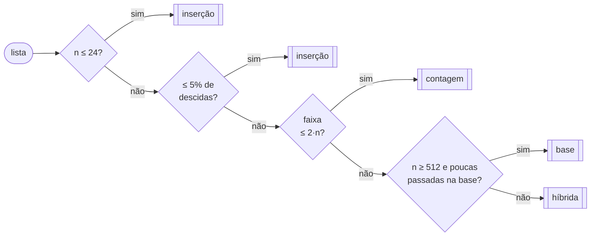

<div align="center">

# 🧠 Ordenação Adaptativa

**Um ordenador que olha a lista e decide sozinho qual algoritmo usar.**


[**📊 Relatório completo**](RELATORIO.md) · [Como rodar](#-como-rodar) · [Como refazer as medições](#-como-refazer-as-medições)

</div>

---

Nenhum método de ordenação ganha sempre: a inserção é imbatível em listas pequenas e quase ordenadas, mas leva segundos numa lista aleatória; a contagem é a mais rápida em faixas estreitas, mas estoura a memória se a faixa for grande. Este projeto reúne **seis métodos** e um **`escolher(v)`** que olha a lista, de forma barata, e decide qual deles usar.

```python
from src import ordenar, escolher

escolher([3, 1, 2])                    # 'insercao'  → lista minúscula
escolher([5, -2, 0, 3, 1] * 2000)      # 'contagem'  → faixa de só 8 valores
ordenar([10**12, -7, 0, 42])           # [-7, 0, 42, 1000000000000]
```

<div align="center">


</div>

> [!IMPORTANT]
> **Resultado:** o `ordenar` fica no máximo **1,30×** atrás do melhor método de cada cenário. O melhor método fixo nesse critério fica **13,9×** atrás no seu pior cenário. Detalhes, regras e o cenário em que ele erra estão no [**RELATORIO.md**](RELATORIO.md).

## 🗺️ Como o `escolher` decide



Cada número desse fluxograma saiu de uma medição: veja a [seção 5 do relatório](RELATORIO.md#5-as-regras-do-escolher-e-de-onde-vieram).

## 📁 Estrutura

```
ordenacao-adaptativa/
├── src/
│   ├── metodos/
│   │   ├── insercao.py        Inserção
│   │   ├── intercalacao.py    Intercalação (merge sort)
│   │   ├── rapida.py          Rápida com pivô aleatório (partição em 3 vias)
│   │   ├── hibrida.py         Rápida + inserção para partes pequenas
│   │   ├── contagem.py        Contagem (com proteção de memória)
│   │   └── base.py            Base / radix LSD, base 256
│   ├── escolher.py            ⭐ decide o método
│   └── ordenar.py             ⭐ chama o escolher e executa
├── tests/
│   ├── test_metodos.py        vazia, 1 elemento, iguais, ordenada, invertida, negativos…
│   └── test_escolher.py       uma lista para disparar cada regra
├── benchmarks/
│   ├── cenarios.py            gera os 4 cenários (semente fixa)
│   ├── medir.py               mede ordenar × 6 métodos → tabelas + gráfico
│   ├── calibrar.py            experimentos que definiram as regras
│   ├── grafico.py             desenha o gráfico
│   └── medicao.py             cronômetro (mediana de rodadas intercaladas)
├── resultados/                saídas geradas (CSV, tabelas, gráfico)
├── README.md
└── RELATORIO.md               📊 o relatório da entrega
```

## 🚀 Como rodar

Requer **Python 3.10 ou mais novo**. Os algoritmos usam só a biblioteca padrão; `pytest` e `matplotlib` são usados apenas nos testes e no gráfico.

```bash
git clone <url-deste-repositório>
cd ordenacao-adaptativa

python -m venv .venv
# Windows:      .venv\Scripts\activate
# Linux/macOS:  source .venv/bin/activate

pip install -r requirements.txt
```

### Rodar os testes

```bash
pytest -v
```

## 🔁 Como refazer as medições

Todos os comandos são executados **na raiz do repositório**.

**1. Tabela dos quatro cenários × seis métodos + gráfico** (~30 s)

```bash
python -m benchmarks.medir
```

Mostra os tempos no terminal e gera:

| Arquivo | Conteúdo |
|---|---|
| `resultados/tabelas.md` | as tabelas do relatório, prontas para colar |
| `resultados/medicoes.csv` | tempos brutos, em segundos por lista |
| `resultados/grafico.png` | o gráfico acima |

**2. Experimentos que definiram as regras do `escolher`** (~10 s)

```bash
python -m benchmarks.calibrar
```

Gera `resultados/calibracao.md` com cinco experimentos: tamanho da lista, amplitude da faixa, tamanho das chaves, grau de desordem e custo de olhar a lista.

**3. Só redesenhar o gráfico** (a partir do CSV já existente)

```bash
python -m benchmarks.grafico
```

> [!NOTE]
> Os números do relatório foram medidos com Python 3.13 em Linux x86_64. Em outra máquina os tempos absolutos mudam, mas os vencedores e as proporções devem se manter. As listas usam **semente fixa**, então os dados de entrada são sempre os mesmos. Para medir com menos ruído, feche outros programas antes de rodar.

### Ajustar os cenários

Tamanhos, faixas e semente ficam no topo de [`benchmarks/cenarios.py`](benchmarks/cenarios.py):

```python
N = 10_000             # tamanho das listas nos cenários grandes
N_MINUSCULA = 10       # tamanho da lista minúscula
QTD_MINUSCULAS = 2_000 # quantas listas minúsculas medir
SEMENTE = 2026
```

## 👥 Autores

| | |
|---|---|
| **Arthur Gabriel Monteiro Barreiras** | Ciência da Computação |
| **Cauã Evaristo da Cruz** | Ciência da Computação |
