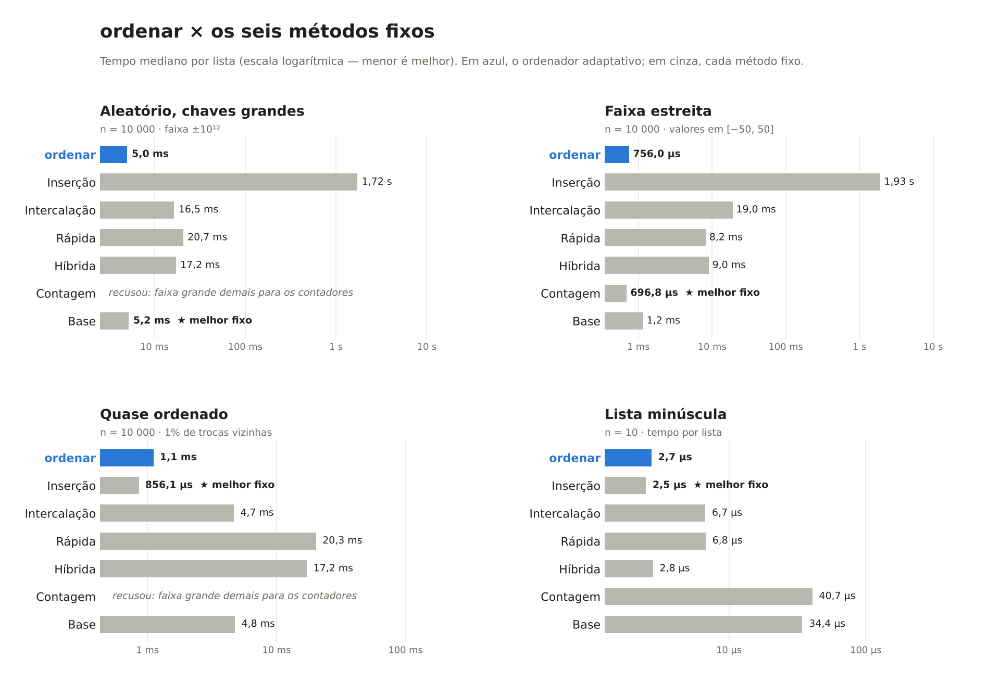
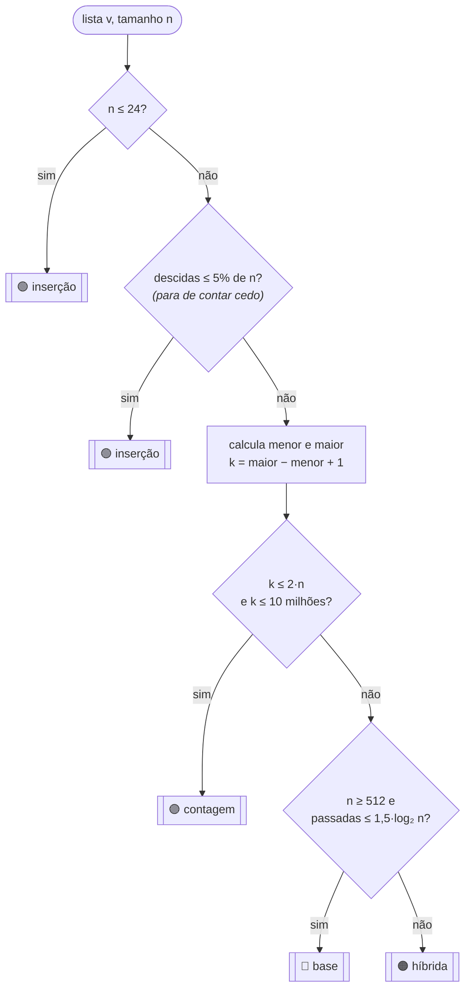

<div align="center">

# 📊 Relatório — Ordenação Adaptativa

**Nenhum método de ordenação ganha sempre. O nosso decide sozinho qual usar.**

Arthur Gabriel Monteiro Barreiras · Cauã Evaristo da Cruz

</div>

---

> [!IMPORTANT]
> **Resultado em uma frase:** nos quatro cenários, o `ordenar` ficou no máximo **1,30×** mais lento que o melhor método daquele cenário. O melhor método fixo nesse critério, a ordenação por **base**, chega a **13,9×** no seu pior cenário. A **inserção** chega a **2.763×**, e a **contagem** nem consegue rodar em dois dos quatro cenários.

## Sumário

1. [Os seis métodos](#1-os-seis-métodos)
2. [Como medimos](#2-como-medimos)
3. [Tabela: quatro cenários × seis métodos](#3-tabela-quatro-cenários--seis-métodos)
4. [Quem venceu cada cenário, e por quê](#4-quem-venceu-cada-cenário-e-por-quê)
5. [As regras do `escolher`, e de onde vieram](#5-as-regras-do-escolher-e-de-onde-vieram)
6. [Quanto custa rodar o `escolher`: ele compensa?](#6-quanto-custa-rodar-o-escolher-ele-compensa)
7. [Onde o `escolher` erra](#7-onde-o-escolher-erra)
8. [Testes](#8-testes)
9. [Conclusão](#9-conclusão)

---

## 1. Os seis métodos

Todos têm a mesma assinatura: recebem uma lista de inteiros e devolvem uma **nova** lista ordenada, sem alterar a original.

| Método | Arquivo | Custo | Memória extra | Onde brilha |
|---|---|---|---|---|
| **Inserção** | [`insercao.py`](src/metodos/insercao.py) | O(n + inversões), pior O(n²) | O(1) | listas minúsculas e quase ordenadas |
| **Intercalação** | [`intercalacao.py`](src/metodos/intercalacao.py) | O(n log n) sempre | O(n) | previsível; pula a intercalação se as metades já estão em ordem |
| **Rápida** (pivô aleatório) | [`rapida.py`](src/metodos/rapida.py) | O(n log n) esperado | O(log n) | caso geral; partição em 3 vias aguenta chaves repetidas |
| **Híbrida** | [`hibrida.py`](src/metodos/hibrida.py) | O(n log n) esperado | O(log n) | rápida até 16 elementos, depois uma passada de inserção |
| **Contagem** | [`contagem.py`](src/metodos/contagem.py) | O(n + k) | **O(k)** | faixa de valores estreita (k pequeno) |
| **Base** (radix LSD, base 256) | [`base.py`](src/metodos/base.py) | O(d · (n + 256)) | O(n) | inteiros com poucas "casas" na base 256 |

> *k* = maior − menor + 1 (amplitude das chaves); *d* = número de passadas = ⌈bits de *k* ÷ 8⌉.

Contagem e base aceitam **negativos**: as chaves são deslocadas pelo menor valor antes de ordenar.

---

## 2. Como medimos

| | |
|---|---|
| **Linguagem** | Python 3.13, Linux x86_64 |
| **Tamanho** | n = 10 000 nos três cenários grandes; n = 10 na lista minúscula (tempo médio sobre 2 000 listas) |
| **Repetições** | mediana de 9 rodadas (3 para quem passa de 0,5 s por rodada) |
| **Intercalação das medidas** | em cada rodada, todos os métodos rodam em **ordem embaralhada**. Assim, variações da máquina (turbo, cache, outros processos) atingem todos por igual, em vez de favorecer quem foi medido por último |
| **Correção** | antes de medir, a saída de cada método é comparada com `sorted()` |
| **Reprodutível** | todas as listas são geradas com semente fixa ([`cenarios.py`](benchmarks/cenarios.py)) |

### Os quatro cenários

| Cenário | Como é gerado |
|---|---|
| **Aleatório, chaves grandes** | 10 000 inteiros uniformes em [−10¹², 10¹²] |
| **Faixa estreita** | 10 000 inteiros em [−50, 50]: só 101 valores possíveis |
| **Quase ordenado** | 10 000 chaves grandes já ordenadas, com 1% de trocas entre vizinhos |
| **Lista minúscula** | listas de 10 inteiros em [−1 000, 1 000] |

---

## 3. Tabela: quatro cenários × seis métodos



### Tempo por lista

🏆 = melhor método fixo do cenário · 💥 = a contagem se recusou a rodar (faixa grande demais para os contadores)

| Método | Aleatório, chaves grandes | Faixa estreita | Quase ordenado | Lista minúscula |
|---|---:|---:|---:|---:|
| Inserção | 1,72 s | 1,93 s | 🏆 **856,1 µs** | 🏆 **2,5 µs** |
| Intercalação | 16,49 ms | 18,97 ms | 4,68 ms | 6,7 µs |
| Rápida | 20,70 ms | 8,17 ms | 20,29 ms | 6,8 µs |
| Híbrida | 17,21 ms | 8,99 ms | 17,24 ms | 2,8 µs |
| Contagem | 💥 recusou | 🏆 **696,8 µs** | 💥 recusou | 40,7 µs |
| Base | 🏆 **5,22 ms** | 1,16 ms | 4,78 ms | 34,4 µs |
| **`ordenar`** | **5,03 ms** | **756,0 µs** | **1,11 ms** | **2,7 µs** |

### Quantas vezes mais lento que o melhor do cenário

Esta é a tabela que responde ao enunciado ("provem que ele ganha de qualquer escolha fixa"). Cada célula é *tempo do método ÷ tempo do melhor método fixo naquele cenário*. A última coluna mostra o **pior caso** de cada um: quanto você perde se apostar sempre naquele método e der azar no cenário.

| Método | Aleatório | Faixa estreita | Quase ordenado | Minúscula | **Pior caso** |
|---|---:|---:|---:|---:|---:|
| Inserção | 329,25× | 2.763,53× | 1,00× | 1,00× | **2.763,53×** |
| Intercalação | 3,16× | 27,22× | 5,47× | 2,72× | **27,22×** |
| Rápida | 3,96× | 11,73× | 23,70× | 2,73× | **23,70×** |
| Híbrida | 3,29× | 12,90× | 20,13× | 1,13× | **20,13×** |
| Contagem | ∞ (recusa) | 1,00× | ∞ (recusa) | 16,47× | **∞** |
| Base | 1,00× | 1,66× | 5,58× | 13,92× | **13,92×** |
| **`ordenar`** | **0,96×** | **1,08×** | **1,30×** | **1,10×** | **🏆 1,30×** |

> [!NOTE]
> O `ordenar` não vence o melhor método **dentro** de cada cenário: ele paga o custo de olhar a lista. Mas cada método fixo é campeão em no máximo dois cenários e desastroso em algum outro. O `ordenar` é o único que fica perto do topo nos quatro. No aleatório ele aparece com 0,96× (levemente mais rápido que a própria base): isso é **empate técnico**, dentro do ruído de medição. Parte do efeito vem de ele reaproveitar o mínimo e o máximo que o `escolher` já calculou (ver seção 6).

---

## 4. Quem venceu cada cenário, e por quê

### 🎲 Aleatório, chaves grandes → **Base**

As chaves vão até ±10¹², ou seja, amplitude de ~2·10¹² (41 bits). A base resolve isso em **6 passadas** de 8 bits, cada uma linear e sem comparar elementos. Os métodos por comparação precisam de ~log₂ 10 000 ≈ 13 níveis, e em Python cada comparação é cara. A inserção é O(n²) e leva quase 2 s. A **contagem** precisaria de 2·10¹² contadores (≈ 16 TB de memória), por isso se recusa.

### 📏 Faixa estreita → **Contagem**

São só 101 valores possíveis para 10 000 elementos. A contagem faz uma passada para contar e outra para escrever: O(n + 101). Nada que compare elementos chega perto disso. A base fica em segundo lugar: com amplitude 100 ela só precisa de **1 passada**, mas paga a criação de 256 baldes. A rápida se sai razoavelmente graças à partição em 3 vias, que trata todas as repetições do pivô de uma vez.

### 📈 Quase ordenado → **Inserção**

A inserção custa O(n + inversões). Com 1% de trocas entre vizinhos há só ~100 inversões, então ela praticamente só percorre a lista uma vez. Todos os outros métodos fazem o trabalho completo de qualquer jeito. A intercalação se sai melhor que a rápida porque pula a intercalação quando as metades já estão em ordem.

### 🔬 Lista minúscula → **Inserção** (empatada com a Híbrida)

Com 10 elementos, o que domina é o **custo fixo** de cada método, não a complexidade assintótica. A inserção tem custo fixo quase zero. A híbrida, com 10 elementos, nem chega a particionar e cai direto na inserção, por isso empata. A contagem e a base pagam por estruturas auxiliares (vetor de contadores, 256 baldes) que não se pagam com tão poucos elementos, e ficam 14–16× mais lentas.

---

## 5. As regras do `escolher`, e de onde vieram

O `escolher` está em [`src/escolher.py`](src/escolher.py). A primeira regra que casar decide:



> Uma **descida** é uma posição onde `v[i] > v[i+1]`. Lista ordenada: 0 descidas; invertida: n − 1.

Cada constante saiu de um experimento em [`benchmarks/calibrar.py`](benchmarks/calibrar.py). As tabelas completas estão em [`resultados/calibracao.md`](resultados/calibracao.md).

| # | Regra | Constante | De onde veio |
|:-:|---|---|---|
| 1 | lista minúscula → inserção | `LIMIAR_PEQUENA = 24` | **Exp. A:** a inserção vence até 24 elementos; em 32 a híbrida já passa à frente |
| 2 | quase ordenada → inserção | `FRACAO_DESCIDAS = 0.05` | **Exp. D:** com trocas entre vizinhos a inserção vence com folga até 8% de descidas; usamos 5% por segurança |
| 3 | faixa estreita → contagem | `FATOR_CONTAGEM = 2` | **Exp. B:** a contagem vence a base até k ≈ 2·n; com 3·n a base já passa |
| 3 | **proteção de memória** | `LIMITE_CONTADORES = 10⁷` | 10 milhões de contadores ≈ 80 MB. Acima disso **nunca** chamamos a contagem: o `escolher` checa **antes**, como o enunciado pede |
| 4 | inteiros "curtos" → base | `MIN_BASE = 512` | **Exp. A:** abaixo de ~512 elementos, criar 256 baldes por passada não compensa |
| 4 | | `FATOR_PASSADAS = 1.5` | **Exp. C:** a base vence com folga até 16 passadas (128 bits) e perde a partir de 24; 1,5·log₂ 10 000 ≈ 20 |
| 5 | resto → híbrida | — | Nos experimentos A e C, é o método por comparação mais rápido no caso geral |

<details>
<summary><b>📋 Ver os dados dos experimentos A, B e C</b></summary>

**A. Tamanho da lista** (chaves grandes, aleatórias; menor tempo em negrito)

| n | insercao | hibrida | intercalacao | rapida | base |
|---:|---:|---:|---:|---:|---:|
| 8 | **1,6 µs** | 1,9 µs | 5,0 µs | 5,3 µs | 100,7 µs |
| 16 | **5,0 µs** | 5,3 µs | 10,9 µs | 11,8 µs | 97,2 µs |
| 24 | **10,1 µs** | 10,2 µs | 19,6 µs | 18,1 µs | 103,4 µs |
| 32 | 17,3 µs | **15,4 µs** | 26,0 µs | 26,0 µs | 113,3 µs |
| 64 | 67,6 µs | **38,4 µs** | 61,5 µs | 58,8 µs | 133,1 µs |
| 256 | 1,39 ms | **241,4 µs** | 437,0 µs | 431,0 µs | 394,6 µs |
| 512 | 3,97 ms | 569,6 µs | 616,6 µs | 709,1 µs | **386,8 µs** |
| 1024 | 17,58 ms | 1,38 ms | 1,57 ms | 1,75 ms | **675,7 µs** |

**B. Amplitude da faixa** (n = 10 000)

| k / n | contagem | base | hibrida |
|---:|---:|---:|---:|
| 0,01·n | **502,0 µs** | 937,6 µs | 8,83 ms |
| 0,1·n | **820,3 µs** | 2,25 ms | 13,68 ms |
| 1·n | **2,83 ms** | 3,46 ms | 23,95 ms |
| 2·n | **1,89 ms** | 2,12 ms | 21,12 ms |
| 3·n | 3,68 ms | **2,08 ms** | 20,27 ms |
| 10·n | 3,76 ms | **2,38 ms** | 16,71 ms |
| 50·n | 13,63 ms | **2,42 ms** | 16,06 ms |

**C. Tamanho das chaves** (n = 10 000)

| bits | passadas | base | hibrida | intercalacao |
|---:|---:|---:|---:|---:|
| 32 | 4 | **3,61 ms** | 16,94 ms | 16,48 ms |
| 64 | 8 | **6,56 ms** | 16,80 ms | 16,15 ms |
| 128 | 16 | **13,72 ms** | 20,49 ms | 18,27 ms |
| 160 | 20 | **16,23 ms** | 18,04 ms | 16,38 ms |
| 192 | 24 | 20,68 ms | 18,56 ms | **17,67 ms** |
| 256 | 32 | 26,26 ms | 16,64 ms | **16,43 ms** |

</details>

---

## 6. Quanto custa rodar o `escolher`: ele compensa?

| Cenário | `escolher` decidiu | Melhor fixo | `ordenar` ÷ melhor | Custo do `escolher` | % do tempo do `ordenar` |
|---|---|---|---:|---:|---:|
| Aleatório, chaves grandes | ✅ `base` | `base` | 0,96× | 335,5 µs | 6,7% |
| Faixa estreita | ✅ `contagem` | `contagem` | 1,08× | 325,8 µs | 43,1% |
| Quase ordenado | ✅ `insercao` | `insercao` | 1,30× | 277,4 µs | 24,9% |
| Lista minúscula | ✅ `insercao` | `insercao` | 1,10× | 93 ns | 3,4% |

**Acertou os quatro cenários.** O custo varia conforme quantas regras precisam ser avaliadas:

- **Lista minúscula: 93 ns.** Só faz `len(v)` e uma comparação.
- **Quase ordenado: ~280 µs.** Precisa percorrer a lista inteira contando descidas, porque não encontra descidas suficientes para parar cedo.
- **Aleatório e faixa estreita: ~330 µs.** A contagem de descidas para cedo (~45 µs), mas depois vêm `min()` e `max()` (~280 µs).

### O aviso do enunciado: "percorrer a lista duas vezes pode anular o ganho"

Levamos o aviso a sério e medimos (**Exp. E**, n = 10 000):

| Operação | Tempo |
|---|---:|
| `min()` + `max()` embutidos: **2 passadas, em C** | 280,0 µs |
| 1 laço em Python calculando min e max: **1 passada, em Python** | 397,9 µs |
| contar descidas **com** parada antecipada | 44,6 µs |
| contar descidas **sem** parada (lista inteira) | 445,8 µs |
| *referência: ordenar com a híbrida* | *16,76 ms* |

Duas conclusões:

1. **Em Python, contar passadas não basta: importa em que linguagem cada passada roda.** Duas passadas com `min()` e `max()`, que são escritos em C, saem ~30% mais baratas que uma única passada escrita em Python. Por isso o `escolher` usa os embutidos.
2. **Parar cedo é o que torna a regra 2 barata.** Numa lista aleatória, a contagem de descidas estoura o limite de 5% depois de olhar ~10% dos elementos e desiste: 45 µs em vez de 446 µs.

E uma otimização: a contagem e a base também precisam de `min` e `max`. Em vez de recalcular, o `ordenar` **repassa** os valores que o `escolher` já descobriu ([`src/ordenar.py`](src/ordenar.py)). Por isso, na faixa estreita, o `escolher` representa 43% do tempo total, mas o `ordenar` fica só 8% atrás da contagem pura: boa parte desse "custo" é trabalho que a contagem teria de fazer de qualquer jeito.

### Compensa?

**Sim, com folga.** No pior caso medido, o `escolher` deixa o `ordenar` 30% mais lento que o método ideal (quase ordenado: +0,25 ms). Já escolher o método errado custa de 3× a 2.700× mais. Em números absolutos: o `escolher` gasta ~0,3 ms; usar a híbrida no quase ordenado custaria +16 ms, e usar a inserção na faixa estreita custaria +1,9 s.

---

## 7. Onde o `escolher` erra

### ❌ Cenário: lista "rotacionada"

```python
v = list(range(5_000, 10_000)) + list(range(0, 5_000))
#   [5000, 5001, ..., 9999, 0, 1, ..., 4999]
```

| Método | Tempo (n = 10 000) |
|---|---:|
| **`ordenar` (escolheu `insercao`)** | **2,02 s** ❌ |
| Base | 1,79 ms ✅ |
| Intercalação | 4,60 ms |
| Híbrida | 16,82 ms |

O `ordenar` ficou **~1.100× mais lento** do que deveria.

**Por que ele erra:** a lista tem só **uma descida** (entre 9999 e 0), então a regra 2 conclui que ela está "quase ordenada" e escolhe a inserção. Mas o que a inserção paga não é o número de descidas, é o **número de inversões**: cada um dos 5 000 elementos da segunda metade precisa andar 5 000 posições, o que dá 25 milhões de deslocamentos (O(n²)).

**O problema de fundo:** contar descidas é barato (O(n), parando cedo), mas mede *quantos lugares estão fora de ordem*, não *o quanto os elementos estão longe do lugar certo*. Contar inversões de verdade custa O(n log n), tanto quanto ordenar.

O mesmo defeito aparece de forma mais sutil no **Exp. D** ([`calibracao.md`](resultados/calibracao.md)): com 1% de trocas entre posições **distantes**, a lista tem só 2% de descidas (abaixo do limiar de 5%), mas a inserção leva 47,7 ms contra 5,1 ms da base: **9× pior**.

| Trocas | % descidas | Inserção | Base | `escolher` decide |
|---|---:|---:|---:|---|
| 1% vizinhas | 1,0% | **783 µs** | 4,48 ms | inserção ✅ |
| 1% distantes | 2,0% | 47,65 ms | **5,11 ms** | inserção ❌ |

Mesma porcentagem de descidas, resultados opostos. **Nenhuma regra baseada só em descidas separa esses dois casos.**

### 💡 Como poderíamos corrigir

1. **Inserção com orçamento:** rodar a inserção contando os deslocamentos; se passar de, por exemplo, 4·n, abandonar e chamar a base ou a híbrida. No caso bom, custo zero a mais; no caso ruim, o prejuízo fica limitado a O(n).
2. **Trocar a inserção por uma intercalação natural** (que aproveita sequências já ordenadas, como faz o Timsort). Na rotacionada ela veria dois blocos ordenados e faria uma única intercalação: O(n).

Não implementamos a correção de propósito, para deixar o erro demonstrável, como pede o enunciado.

---

## 8. Testes

```bash
pytest -v
```

**138 testes** em [`tests/`](tests/), cobrindo os seis métodos **e** o `ordenar`:

| Caso | Exemplo |
|---|---|
| lista vazia | `[]` |
| um elemento | `[42]` |
| todos iguais | `[7] * 100` |
| já ordenada | `range(200)` |
| invertida | `range(200, 0, -1)` |
| valores negativos | `[-5, 3, -1, 0, -100, 99, -5, 2]`, só negativos, zeros e negativos |
| chaves enormes | `±10¹⁵` |
| aleatórias | 6 tamanhos × 3 faixas, comparadas com `sorted()` |
| não altera a entrada | a lista original continua igual |
| sem estourar recursão | lista invertida de 20 000 elementos |
| proteção de memória | a contagem recusa faixa gigante; o `ordenar` nunca a chama nesse caso |

Desses, 11 testam só as regras do `escolher` ([`test_escolher.py`](tests/test_escolher.py)): cada regra tem uma lista feita para dispará-la.

---

## 9. Conclusão

| Pergunta | Resposta |
|---|---|
| Algum método fixo ganha sempre? | **Não.** Cada um vence no máximo dois cenários e perde feio em outro (13,9× a 2.763×, ou se recusa a rodar). |
| O `ordenar` ganha de qualquer escolha fixa? | **Sim, no pior caso.** Ele fica no máximo 1,30× atrás do melhor de cada cenário; o melhor fixo nesse critério (base) fica 13,9× atrás. |
| O `escolher` compensa? | **Sim.** Custa de 93 ns a ~0,3 ms; um erro de escolha custa de milissegundos a segundos. |
| Ele é infalível? | **Não.** Listas com poucas descidas, mas elementos muito longe do lugar (rotacionada, trocas distantes), o enganam. |

> [!TIP]
> Para refazer todas as medições na sua máquina, veja a seção **"Como refazer as medições"** do [README](README.md). Os tempos absolutos vão mudar, mas as proporções e os vencedores devem se manter.
